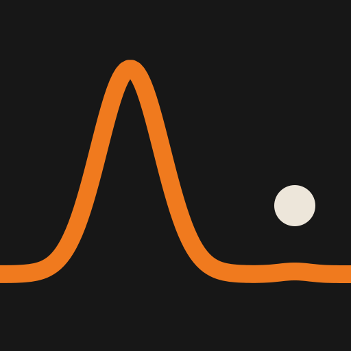

<p align="center">
  
</p>

# antialgorithm

<p align="center">
  <a href="https://github.com/mankidev/antialgorithm/releases"></a>
  <a href="../LICENSE"></a>
  <a href="https://github.com/mankidev/antialgorithm/stargazers"></a>
</p>

<p align="center"><sub><a href="../README.md">English</a> | <a href="README_TR.md">Türkçe</a> | <a href="README_ZH.md">简体中文</a> | <a href="README_JA.md">日本語</a> | <a href="README_KO.md">한국어</a> | <a href="README_ES.md">Español</a> | <a href="README_PT.md">Português</a> | <a href="README_DE.md">Deutsch</a> | <a href="README_FR.md">Français</a> | Русский</sub></p>


Скилл для агентов для творческой работы: названия, истории, идеи для игр, постеры, интерфейсы. Он заставляет модель сначала назвать свой первый, самый усреднённый вариант, а потом уйти от него по причине, взятой из проекта.

Оба ряда получены из одного и того же промпта: `Design a poster for a music festival as a 400x600 SVG. Save the final SVG as final.svg in the current folder.` Верхний ряд: шесть запусков без скилла подряд, ни один не выброшен. Нижний ряд отобран примерно из дюжины запусков, сделанных, пока скилл ещё писался.


## Установка

CLI [skills](https://github.com/vercel-labs/skills) кладёт его туда, откуда ваш агент читает скиллы, для Codex, Cursor, OpenCode, Claude Code и других:

```
npx skills add mankidev/antialgorithm
```

Или клонируйте его в папку скиллов вашего агента:

```
git clone https://github.com/mankidev/antialgorithm <папка скиллов>/antialgorithm
```

В Claude Code он также ставится как плагин (в версиях до 2.1.275 сначала выполните `/plugin marketplace add mankidev/antialgorithm`):

```
/plugin install antialgorithm --marketplace mankidev/antialgorithm
```

Скриптам нужен Python 3. Для `check.py` также нужны numpy, Pillow и `rsvg-convert` (или пакет cairosvg).

## Скрипты

`seed.py` выбрасывает отправную точку, когда в запросе мало данных. Визуальное зерно даёт способ изготовления, цвета, композицию, шрифт, глагол и масштаб для идеи, место действия, регион и, в половине случаев, предмет. Текстовое зерно даёт голос, способ войти в текст и регистр. Зерно идеи даёт глагол, ограничение, масштаб и давление. Случайность берётся из системы, поэтому два человека с одинаковым промптом начинают с разных мест. Каждое зерно сохраняется в `~/.local/state/antialgorithm/history.jsonl` (внутри `$XDG_STATE_HOME`, если переменная задана), а значения последних нескольких пропускаются, чтобы ваши зёрна не повторялись от сессии к сессии. Обновления плагина этот файл не трогают. `--keep "axis=value"` фиксирует одну ось: тема остаётся, а заново выпадает только внешний вид.

`moves.py` ведёт короткий журнал главного хода каждого ответа, который уходит от варианта по умолчанию, например "neon tube wall, almost no type". Модель читает его перед тем, как показать новую работу, и не повторяет ход только потому, что в прошлый раз он сработал.

`rough.py` берёт SVG, расшатывает прямые линии, фигуры и буквы и ломает ровный шаг повторяющихся элементов, чтобы нарисованный кодом «ручной» вид перестал выглядеть как вывод плоттера. Он нужен только для ручных техник: печати, краски, штампов и туши. Экранные, фото- и рендер-стили сохраняют свои собственные следы.

`check.py` рендерит SVG в полном размере и в размере иконки и перечисляет текст, который вылезает за край, прячется под фигурой, плохо контрастирует или слишком мелкий. Порог размера рассчитан на постеры; для экрана приложения используйте `--min-text 0.6`.

Визуальные правила лежат в `visuals.md`. Модель читает этот файл только при визуальной работе, так что название или слоган его не подгружают.

## Лицензия

MIT

## История звёзд

<a href="https://star-history.com/#mankidev/antialgorithm&Date">
  <picture>
    <source media="(prefers-color-scheme: dark)" srcset="https://api.star-history.com/svg?repos=mankidev/antialgorithm&type=Date&theme=dark">
    
  </picture>
</a>
